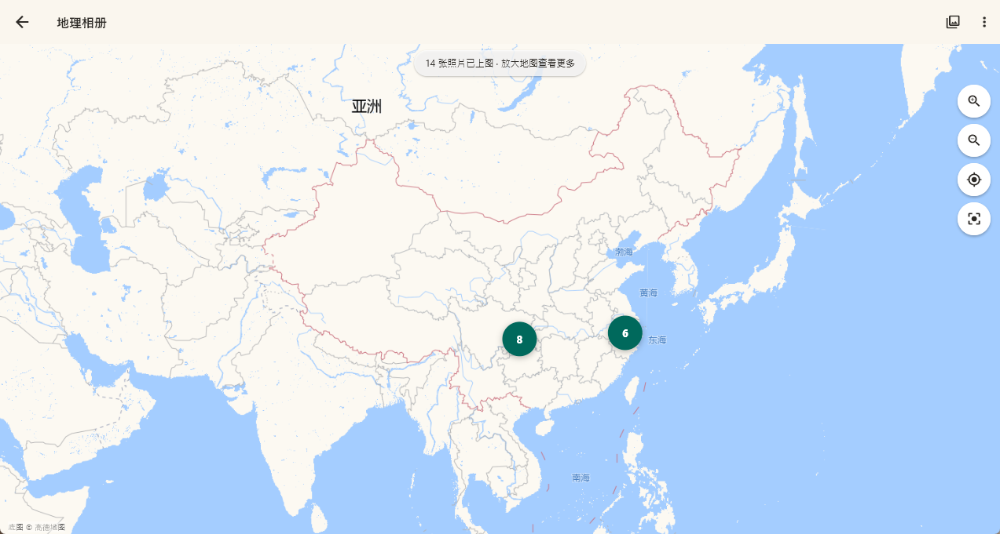
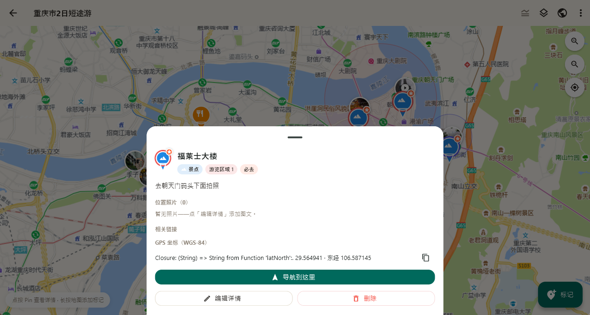
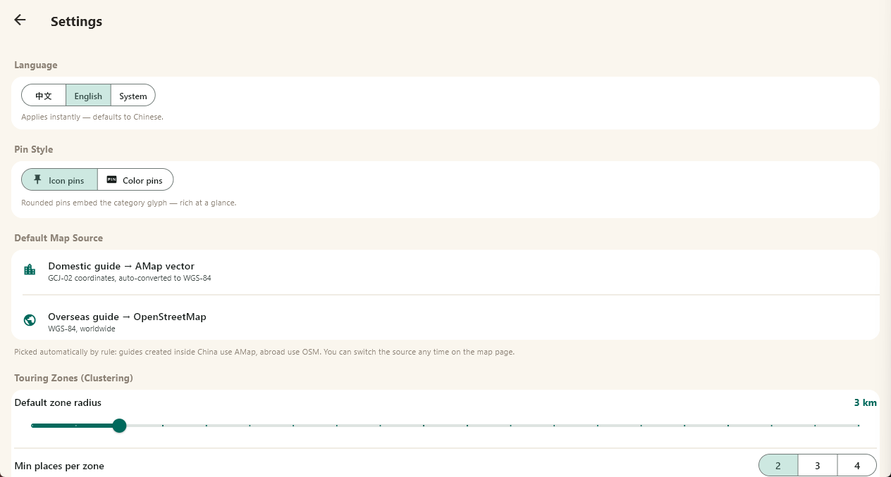

# AtmaBook — Offline Travel Guide Map & Photo book

> An offline-first Flutter travel guide app with the map as its primary canvas — guides with map markers, touring areas clustered from "must-visit" points with recommended routes, a geo album for geotagged photos and videos, and single-file share packs for sharing or permanent backup. **All data stays on your device: no servers, no accounts. You never need to worry about data loss, software being taken down, or the service provider shutting down.**
>
> 一款以地图为主画布的 Flutter 离线旅行攻略应用：图文标记游玩地点、自动聚类"必去"点生成游览片区与推荐路径、带 GPS 的照片与视频铺成地理相册、一键打包为单文件攻略与他人分享或作为永久备份。**全量数据仅存于本机，不依赖任何服务器、不注册任何账号，你永远不需要担心数据丢失或软件下架，运营商关闭。**


   

- Package name: `atma_book` · Windows executable: `atma_book.exe` · Android applicationId: `com.example.atma_book`
- Delivered platforms: **Windows desktop & Android**（iOS / Linux / Web 为预埋工程：iOS/Linux 须在对应系统构建，Web 为开发预览入口 / pre-wired scaffolding: iOS/Linux builds must run on their respective OS, Web is a developer preview entrence.）

## Documentation · 完整文档

| 语言 | 文档 |
| --- | --- |
| 中文（完整说明） | [docs/README.zh-CN.md](docs/README.zh-CN.md) |
| English (full documentation) | [docs/README.en-US.md](docs/README.en-US.md) |

## Highlights · 功能亮点

- **Guide & map · 攻略与地图**：multiple keyless basemaps + offline tile packs · 多种免密钥底图与离线瓦片包；long-press markers with photos/links/categories · 长按添加图文标记

- **Touring areas · 片区与路径**：DBSCAN clustering of must-visit points + 2-opt/OSRM routes · "必去"点聚类成片区，最近邻 + 2-opt 优化、OSRM 路网吸附

- **Geo album · 地理相册**：geotagged photos & videos, auto-assignment, map photo wall · 照片/视频自动归属、地图照片墙

- **Guide notes · 攻略笔记**：auto-generated readable itinerary, zero extra storage · 自动生成可通读行程文档，零新增存储

- **Share & backup · 分享与备份**：single-file `.tgshare` (watermarked or original quality) and `.tgbundle` full export · 单文件 `.tgshare`（水印版/原片版）与 `.tgbundle` 全量导出

- **Category management · 分类管理**：recolor/re-icon built-ins, custom categories, 1:1 image pin icons · 内置分类改色换图标、自定义分类、1:1 图片 Pin 图标
- **i18n · 中英双语**：587 entries, instant switching · 切换即时生效


## Third-party runtime & large files — read before building · 第三方依赖与解码组件（构建前必读）

This repository ships **source code only**. The following are not committed and must be provided locally:

本仓库只含源码与工程配置，以下内容不在仓库内，需按说明自备：

1. **FFmpeg runtime — `ffmpeg_runtime/`（Windows 构建必需）**
   - EN: Each binary (~160 MB) exceeds GitHub's 100 MB file limit, so it is not in this repository. The Windows build's post-build step deploys this folder into the output directory and **fails if the folder is missing**. Download a **GPL build that includes libx264** (e.g. gyan.dev `release-full`, or BtbN `win64-gpl` from [github.com/BtbN/FFmpeg-Builds/releases](https://github.com/BtbN/FFmpeg-Builds/releases)) and place `ffmpeg.exe` + `ffprobe.exe` under `ffmpeg_runtime/` at the repository root. Without them: original-quality export & the full-export bundle still work; watermarked video transcoding and first-frame thumbnails degrade gracefully.
   - 中文：单个可执行文件约 160 MB，超过 GitHub 单文件 100 MB 上限，故不随仓库分发。Windows 构建的后置部署步骤会把该目录整体拷入产物目录，**目录缺失会导致构建失败**。请自行下载**含 libx264 的 GPL 构建**（如 gyan.dev `release-full`、BtbN `win64-gpl`），把 `ffmpeg.exe` 与 `ffprobe.exe` 放入仓库根目录 `ffmpeg_runtime/`。缺 FFmpeg 时：原片高清导出与全量导出包不受影响；视频水印转码与首帧缩略自动降级，不阻塞业务。
2. **media_kit codec components (mpv / ANGLE) — 构建期自动获取**
   - Fetched automatically on the first Windows build; offline machines may pre-place `ANGLE.7z` + `mpv-dev` (win64) archives in the optional `build_cache/` directory.
   - Windows 首次构建自动联网获取；完全离线环境可把 `ANGLE.7z` 与 `mpv-dev`（win64）压缩包预先放入可选目录 `build_cache/`。
3. **Packaged installers — `release/`（不入库）**
   - Build them yourself with the commands below, or check the repository's Releases page. Windows installer: root `installer.iss` (Inno Setup).
   - 成品安装包（APK / Windows 安装器）不随仓库分发：自行按下方命令构建，或到 Releases 页获取；Windows 安装器由根目录 `installer.iss`（Inno Setup）打包。

## Build quickstart · 构建速览

```bash
flutter pub get
flutter gen-l10n
flutter analyze --no-pub   # gate: 0 issue
flutter test               # gate: all green

flutter build windows      # place ffmpeg_runtime/ first（先自备 ffmpeg_runtime/）
flutter build apk
```

Requirements: Flutter stable (Dart SDK ^3.13.5) with platform toolchains · Visual Studio 2022 desktop C++ workload for Windows · Android SDK 34+ for Android. Full details in the documentation above.

## AI-Assisted Development · AI 辅助开发

- EN: This application is **AI-assisted**: developed with **OpenCode**, an open-source AI coding agent, using the **GLM-5.3 Flash** model; every change was accepted manually, feature by feature.
- 中文：本应用由 **AI 辅助开发**：全程使用 **OpenCode** 辅助编程，采用模型 **GLM-5.3 Flash**；所有变更均经人工逐项验收。

## License · 许可

**Apache License 2.0** — see [`LICENSE`](LICENSE). Third-party components are inventoried in [`THIRD-PARTY-NOTICES.md`](THIRD-PARTY-NOTICES.md): code Apache-2.0 · map data ODbL (© OpenStreetMap contributors) · media binaries GPL family, see the notices.

**Apache License 2.0**——见根目录 [`LICENSE`](LICENSE)；第三方组件逐件清单见 [`THIRD-PARTY-NOTICES.md`](THIRD-PARTY-NOTICES.md)：代码 Apache-2.0 · 地图数据 ODbL（© OpenStreetMap contributors）· 媒体二进制 GPL 家族，详见 notices。
